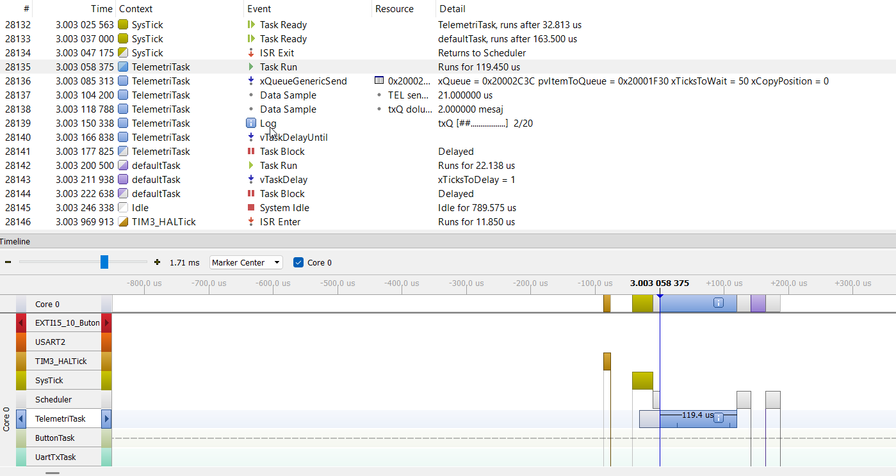
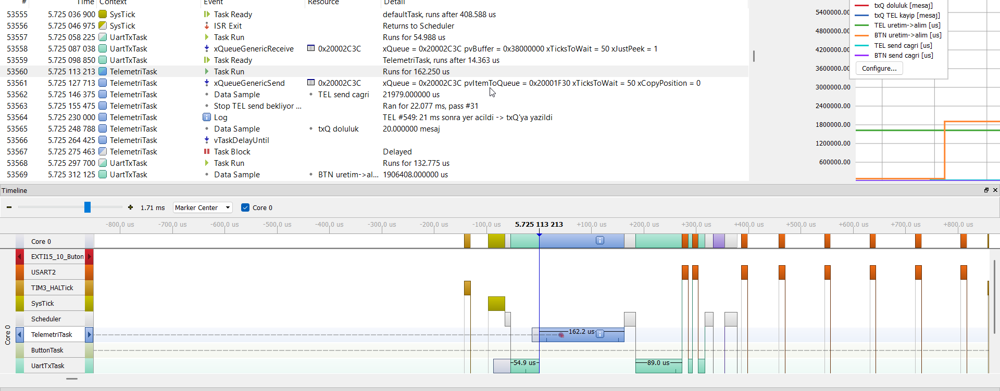
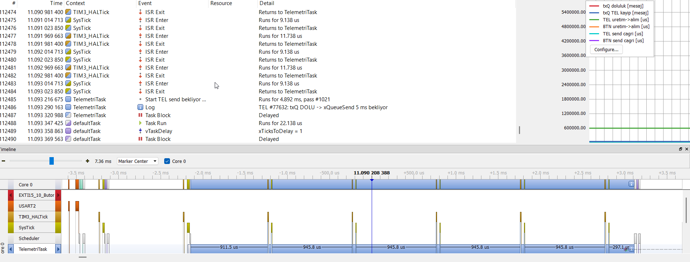
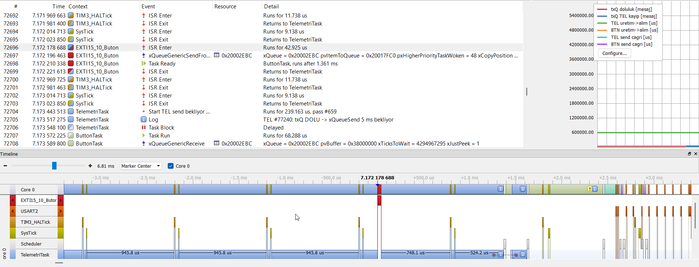
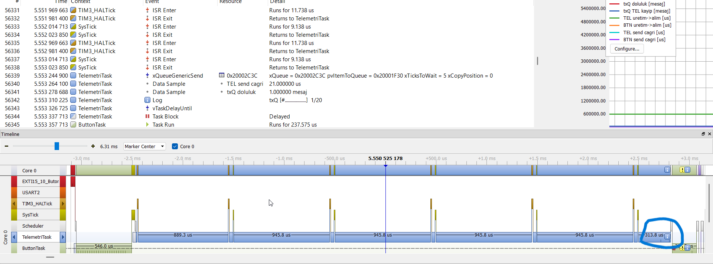
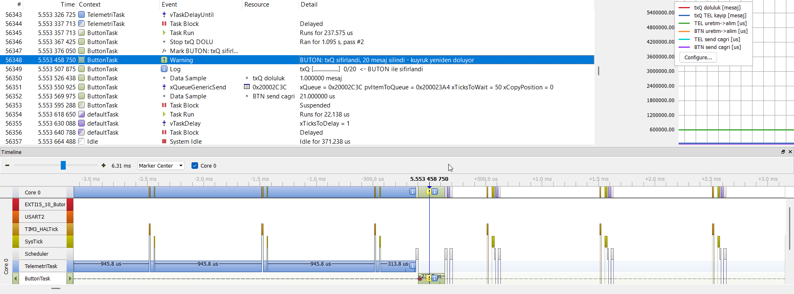
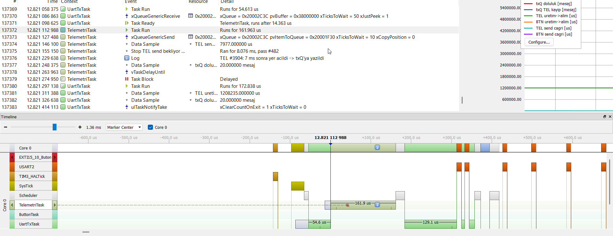

Bu görsel S1 senaryosunun görselidir. Telemetri taskı 100ms de bir çalışmaktadır.

Burada UartTxTask queue'dan veriyi okuyor ve yer açılıyor. Bu yer açılması ile birlikte Telemetri taskında queueSend'in 50 ms TickToWait süresi içerisinde 21. milisaniyede yer açılıyor ve queue ya veriyi basıyor.

Burada senaryo 5 de yapılan ölçüm değerinden bir kesit bulunmakta. Senaryo 5 telemetri taskının 10ms olarak ayarlanıp 5ms de ek yük altında olduğu senaryo. İlk hafta ödevinde bazı button basmalarını atladığı senaryo.

Örnek olarak burada buttonISR ile buttonu algılıyor ama 1.361ms sonra çalıştırıyor. 1 milisaniyeden daha uzun bir süre geçiyor.

Burada da yoğun yük altında buttona bastıktan sonra telemetri taskı sistemi çok fazla meşgul ediyor ve uzun zaman sonra çalışıp queue ya verisini basıyor. Veriyi bastıktan sonra button taskı queue boşaltı mesajlarını veriyor ve bloklanıyor 'S5_Queue_Bosaltı_Mesaj görseli'. 

Açıklama

S1 den S5 e kadar olan tüm senaryolarda testler ve SEGGER Systemview da incelemeler yapıldı. S1 durumunda Telemetri Taskının queue'ya veri bastığı kısımlar incelendi. Queue'dan veri okuduğu kısımlar incelendi. QueueReceive TickToWait 50 ms olarak ayarlanmıştı ve queue dolu olduğu durumlarda send işlemi için 50 ms beklenip queue da yer açılmadığı için task blok durumuna geçiyor. Telemetri taskı 3 veri basarken UartTxTask 1 veri okuyacak şekilde ayarlı. 1 veri okunup queue'dan veri azaldığı az Telemetri task Ready durumuna geçerek çalışıyor. 50ms lik TickToWait sürelerinde incelemelerim sonucunda 27, 21 gibi ms süreleri sonra yer açılarak queue ya veri yazma işlemi gerçekleşiyor.
Bu görselde S2 durumunda Telemetri taskı 20ms de çalışır durumunda QueueSend için 10ms TickToWait süresi ayarlı. Bu durumdayken queue da 7ms de yer açılarak veri yazılıyor. S1 durumuna göre çalışma süreleri farklı olduğu durumlar göz önünde bulundurularak anlaşılıyor ki queue 21ms den 7ms e kadar düşüyor.
